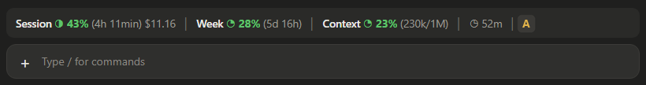
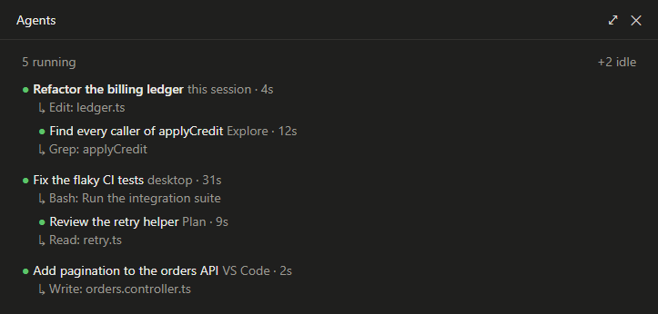
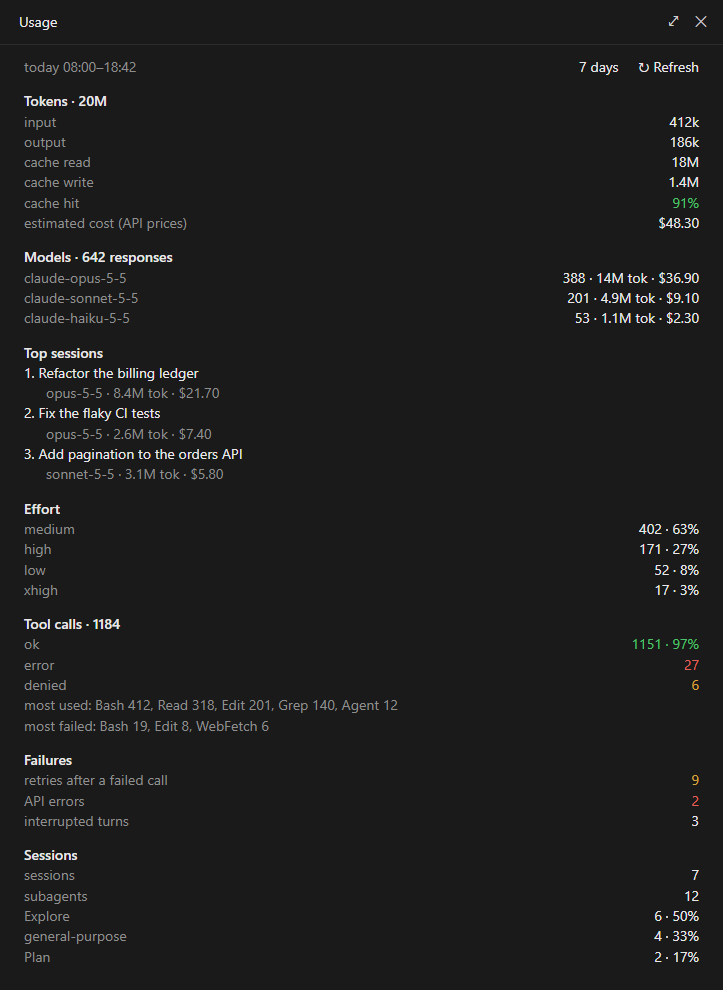
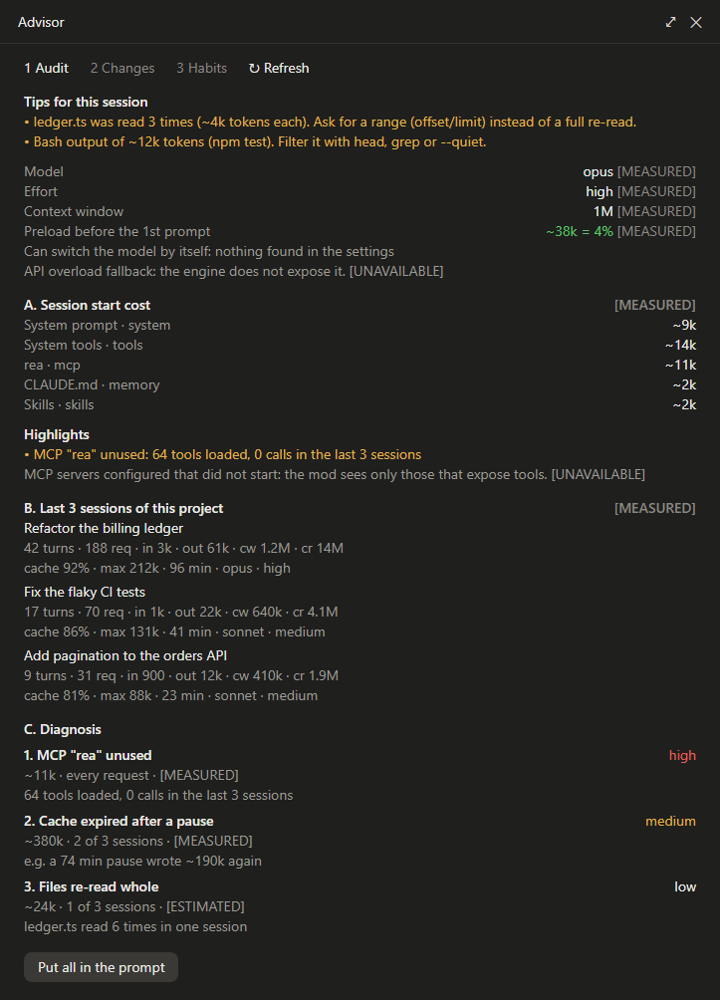

# claude-mods

A collection of mods (plugins) for Claude Code. Each mod lives in its own folder under `plugins/`, and this repository is a plugin marketplace, so every mod installs with one line.

## Mods

| Mod | What it does |
| --- | --- |
| [usage-bar](plugins/usage-bar) | One-line usage meter above the prompt, in English: current session and this week, with percent, progress ring and time to reset, the context window fill, the session cost and a prompt-cache countdown. Updates every minute and follows what other sessions spend. |
| [workspace](plugins/workspace) | A side pane titled Agents: this session and every session or agent running on the machine (desktop, terminal, VS Code), with what each is doing. Idle ones hide behind `+N idle`. Clicking a title opens that chat. Opens by itself in the desktop app; `/workspace` or the chip above the prompt opens it anywhere. |
| [usage-report](plugins/usage-report) | `/report` opens a pane with today's usage (`/report week` for 7 days) across every session on the machine: tokens, cache hit rate, estimated cost, models, top sessions, effort levels, tool calls (ok, error, denied), retries, API errors, interrupted turns, sessions and subagents. Written in the operating system's language (English or Portuguese). |
| [usage-advisor](plugins/usage-advisor) | Watches how the session spends tokens: whole files read again, large tool outputs, context fill, cold cache after a pause, model switches, and the preload. An `A` at the end of usage-bar's line lights up when the session calls for tips; a click opens the audit. `/advisor` opens a pane with an audit of the project: what loads before the first prompt, the last 10 sessions, a diagnosis ranked by impact, changes to approve one at a time, and the three habits that would save the most. Each figure is marked measured, estimated or unavailable. Written in the operating system's language (English or Portuguese). |
| [model-router](plugins/model-router) | Optional, not installed by default. Rates each prompt on two things: how capable the model must be (haiku, sonnet or opus) and how much checking the work needs (effort from low to xhigh). The first prompt locks the model, which only moves up when a later prompt needs it; the effort follows each prompt. A bare `ok` or `continue` is never rated. Subagents get their own model and effort. `/route` shows or overrides the choice, `/route eval` measures the router on 62 labeled prompts, and `/route log` lists your overrides. |

## What they look like

The names and numbers in these pictures are made up for the example.

### usage-bar

The line above the prompt: the session and the week with time to reset, the context window fill, the prompt-cache countdown and usage-advisor's `A` at the end.



### workspace

The Agents pane: this session and its subagents, then the other sessions running on the machine.



### usage-report

The pane `/report` opens.



### usage-advisor

The Audit tab of the pane `/advisor` opens, or a click on the `A`.



model-router has no picture: it shows only a `route <model>/<effort>` entry in the status line and the text of `/route`.

## Install

Add the marketplace once, then install each mod you want. User scope makes a mod load in every session, desktop app included.

The default set is usage-bar, workspace, usage-report and usage-advisor. model-router is off by default because it changes the model and effort of your sessions; install it only if you want that.

From a shell:

```bash
claude plugin marketplace add pedrojr/claude-mods
claude plugin install usage-bar@claude-mods --scope user
claude plugin install workspace@claude-mods --scope user
claude plugin install usage-report@claude-mods --scope user
claude plugin install usage-advisor@claude-mods --scope user
```

To add model-router as well:

```bash
claude plugin install model-router@claude-mods --scope user
```

To keep it installed but turned off:

```bash
claude plugin disable model-router@claude-mods
```

At the prompt of a Claude Code terminal session:

```
/plugin marketplace add pedrojr/claude-mods
/plugin install usage-bar@claude-mods
```

In the desktop app, where `/plugin` does not run: click **+** next to the prompt box, then **Plugins**, **Add marketplace** with `pedrojr/claude-mods`, then **Add plugin**.

### Installing with Claude

When you ask Claude to install these mods, it should install usage-bar, workspace, usage-report and usage-advisor without asking, then ask whether you also want model-router, and install it only on a yes.

A mod loads when a session starts: sessions already open do not pick up a new install. To update later, run `claude plugin marketplace update claude-mods`, then start a new session.

If the repository is private, the install works only for people who can read it on GitHub and whose machine already holds a git credential for github.com (an SSH key, or `gh auth login` then `gh auth setup-git`).

## Adding a mod

1. Create `plugins/<mod-name>/` with `.claude-plugin/plugin.json`, `hooks/hooks.json` and the hooks module.
2. Add an entry to `.claude-plugin/marketplace.json` with `"source": "./plugins/<mod-name>"`.
3. Run `claude plugin validate plugins/<mod-name>` before pushing.

## License

MIT, see [LICENSE](LICENSE).
