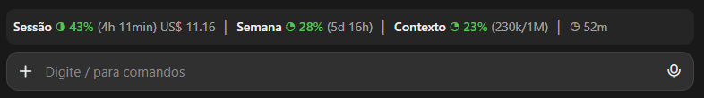
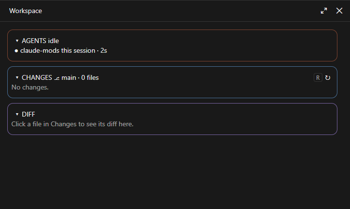
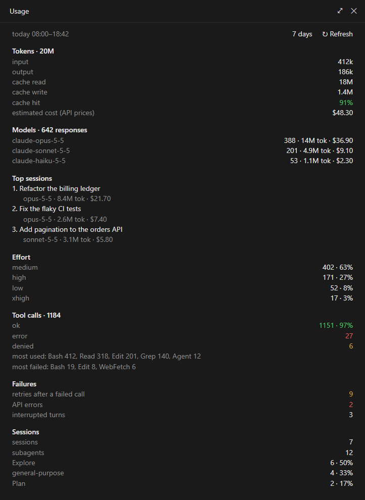

# claude-mods

A collection of mods (plugins) for Claude Code. Each mod lives in its own folder under `plugins/`, and this repository is a plugin marketplace, so every mod installs with one line.

## Mods

| Mod | What it does |
| --- | --- |
| [usage-bar](plugins/usage-bar) | One-line usage meter above the prompt: current session and this week, with percent, bar and time to reset, the context window fill, the session cost and a prompt-cache countdown. Updates every minute and follows what other sessions spend. |
| [workspace](plugins/workspace) | One side pane in three framed sections, each in its own light color. Agents: this session and every session or agent running on the machine (desktop, terminal, VS Code), with what each is doing; idle ones hide behind `+N idle`, and clicking a title opens it. Changes: the repository's changed files grouped as in VS Code (Conflicts, Staged, Not staged) with their status letters. Diff: the file you click in Changes, with line numbers, added and removed lines and syntax colors. Each section folds to its title line. Opens by itself in the desktop app; `/workspace` or the chip above the prompt opens it anywhere. |
| [usage-report](plugins/usage-report) | `/report` opens a pane with today's usage (`/report week` for 7 days) across every session on the machine: tokens, cache hit rate, estimated cost, models, top sessions, effort levels, tool calls (ok, error, denied), retries, API errors, interrupted turns, sessions and subagents. |
| [model-router](plugins/model-router) | Rates each prompt on two things: how capable the model must be (haiku, sonnet or opus) and how much checking the work needs (effort from low to xhigh). The first prompt locks the model, which only moves up when a later prompt needs it; the effort follows each prompt. A bare `ok` or `continue` is never rated. Subagents get their own model and effort. `/route` shows or overrides the choice, `/route eval` measures the router on 62 labeled prompts, and `/route log` lists your overrides. |

## What they look like

### usage-bar

The line above the prompt: the session and the week with time to reset, the context window fill and the prompt-cache countdown.



### workspace

The side pane with its three sections: Agents, Changes and Diff.



### usage-report

The pane `/report` opens. The numbers in this picture are made up for the example.



model-router has no picture: it shows only a `route <model>/<effort>` entry in the status line and the text of `/route`.

## Install

Add the marketplace once, then install each mod you want. User scope makes a mod load in every session, desktop app included.

From a shell:

```bash
claude plugin marketplace add pedrojr/claude-mods
claude plugin install usage-bar@claude-mods --scope user
claude plugin install workspace@claude-mods --scope user
claude plugin install usage-report@claude-mods --scope user
claude plugin install model-router@claude-mods --scope user
```

At the prompt of a Claude Code terminal session:

```
/plugin marketplace add pedrojr/claude-mods
/plugin install model-router@claude-mods
```

In the desktop app, where `/plugin` does not run: click **+** next to the prompt box, then **Plugins**, **Add marketplace** with `pedrojr/claude-mods`, then **Add plugin**.

A mod loads when a session starts: sessions already open do not pick up a new install. To update later, run `claude plugin marketplace update claude-mods`, then start a new session.

If the repository is private, the install works only for people who can read it on GitHub and whose machine already holds a git credential for github.com (an SSH key, or `gh auth login` then `gh auth setup-git`).

## Adding a mod

1. Create `plugins/<mod-name>/` with `.claude-plugin/plugin.json`, `hooks/hooks.json` and the hooks module.
2. Add an entry to `.claude-plugin/marketplace.json` with `"source": "./plugins/<mod-name>"`.
3. Run `claude plugin validate plugins/<mod-name>` before pushing.

## License

MIT, see [LICENSE](LICENSE).
