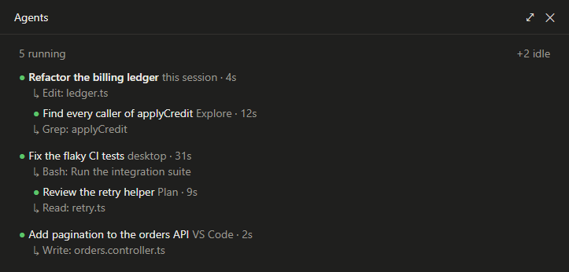

# workspace

A side pane titled **Agents** that lists the sessions and agents running on the machine. Clicking one opens its chat.

## What it lists

- Sessions from every surface on the machine (desktop app, terminal, VS Code), with their agents and subagents nested under them. They come from the registry Claude Code keeps in `~/.claude/sessions/`.
- This session is always listed, plus every session and agent that is running. Idle ones (finished, prompt cache still warm) are hidden behind `+N idle` on the top line; click it to list them, and `hide idle` to hide them again. Items whose prompt cache has expired (1 hour after their last write) are not listed.
- The dot is green while the item runs and gray otherwise. Next to the title is where it runs (or the agent type) and how long ago it last wrote.
- Under a running item, `↳` shows what it is doing: its latest tool call (`Bash: Run tests`), the first line of its last reply, or its last prompt.

## What a click opens

- **This session** goes back to its main conversation.
- **An agent of this session** puts its transcript in the main view. `← Main` (or `m`) on the top line goes back.
- **A session in the desktop app** opens that chat in the app through its link `claude://code/continue?session=local_<id>`. The app follows the link only while you are signed in.
- **A session in VS Code** focuses the VS Code window of its folder (`code <folder>`), then opens the session through `vscode://anthropic.claude-code/open?session=<id>`. If `code` is not on the PATH, a toast says where the session runs.
- **A session in the terminal** cannot be brought to the front by a mod, so a toast says where it runs.
- **An agent of another session** opens the session it belongs to.

## When it updates

Every 3 seconds the pane reads the session registry again, plus the transcripts that changed. It also reads them when an agent is spawned and at the end of every turn.

## Opening it

- **Desktop app (and other app surfaces):** the pane opens by itself when the session starts and whenever an agent is spawned.
- **Terminal:** the pane opens only when you ask. With the transcript in fullscreen mode it docks on the right; otherwise it sits above the prompt.
- **`/workspace`** opens it on any surface. It also runs mid-turn, while agents are working. The command keeps the mod's name because Claude Code already has a built-in `/agents`.
- **`● 1 other session active · 2 agents running [Agents]`**: while the pane is closed and something else runs, this one-line chip sits above the prompt, and its button opens the pane.

Once you close the pane, it stops opening by itself for the rest of that session. The chip and `/workspace` still bring it back.

## Cost

No model tokens: the mod runs outside the conversation. The only footprint in the conversation is the `/workspace` entry in the command list.

## Settings

None. The constants are at the top of the files: `POLL_MS` and `DOCK_COLUMNS` in `hooks/register.tsx`, and `CACHE_TTL_MS` in `hooks/agents.ts` (set it to 5 minutes if your prompt cache lives 5 minutes).

## Limits

The session registry and transcript layout under `~/.claude` are Claude Code internals, not a public format. A future version may change them and empty the list until the mod is updated.

## Privacy

The mod reads local files under your Claude Code config folder (`CLAUDE_CONFIG_DIR`, or `~/.claude`). Nothing leaves the machine. Opening a desktop session runs the OS's URL opener (`rundll32 url.dll,FileProtocolHandler` on Windows, `open` on macOS, `xdg-open` on Linux) with the app's `claude://` link. Opening a VS Code session runs the `code` command.
